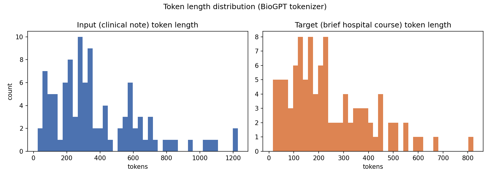
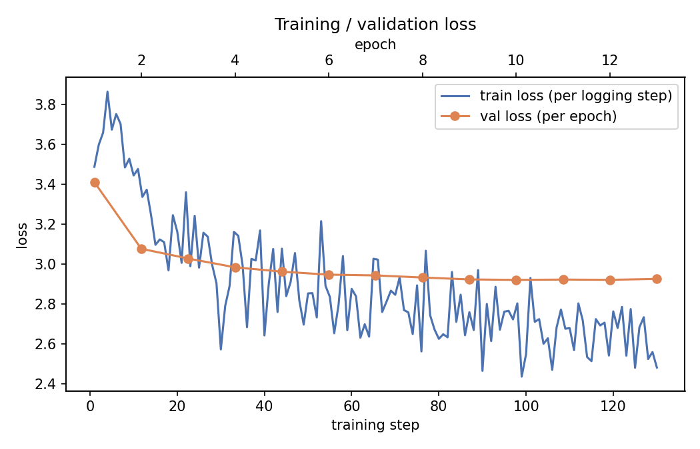
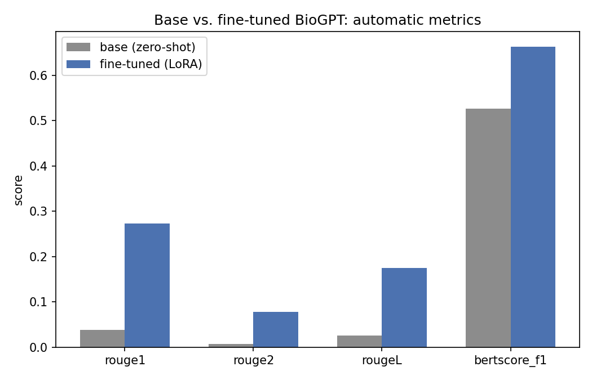
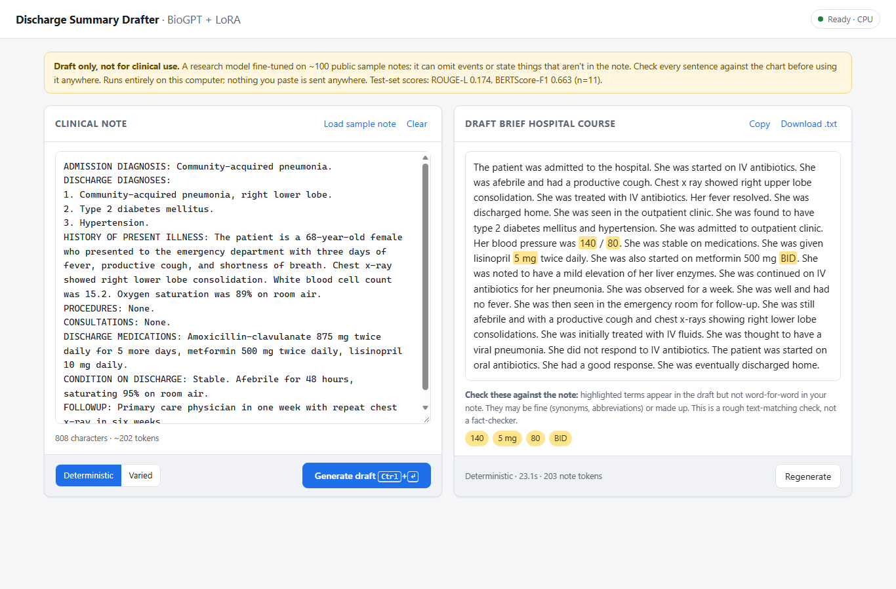

# Model Card: BioGPT-LoRA Brief Hospital Course Drafter

Every number in this card comes from an actual run of this repository. The sources are files
in [`outputs/`](outputs/) and the executed Colab notebook. Nothing is estimated or written by
hand.

## Model details

| | |
|---|---|
| **Model** | LoRA adapter for [`microsoft/biogpt`](https://huggingface.co/microsoft/biogpt) ([`checkpoints/lora_adapter/`](checkpoints/lora_adapter/)) |
| **Task** | Generate the *Brief Hospital Course* (BHC) section of a discharge summary from the rest of the clinical note |
| **Base model** | BioGPT (347M-parameter GPT-2-style causal LM, pretrained on 15M PubMed abstracts; Luo et al., 2022) |
| **Fine-tuning method** | LoRA (Hu et al., 2021): rank 16, alpha 32, dropout 0.05, on the attention projections `q_proj`, `k_proj`, `v_proj`, `out_proj` |
| **Trainable parameters** | 3,145,728 of 349,908,992 (0.899%) |
| **Adapter size** | 12.6 MB (`adapter_model.safetensors`) |
| **Developed by** | Aviral Goel ([@goelavi04](https://github.com/goelavi04)) |
| **Date** | October 2026 |
| **Frameworks** | transformers 4.46.3, peft 0.13.2, PyTorch (Colab CUDA build) |
| **License** | Base model BioGPT is MIT-licensed. Training data: MTSamples (publicly available sample transcriptions). No license has been chosen yet for this repository's code. |
| **Status** | Research and teaching prototype. **Not clinically validated, and not for patient care.** |

## Intended use

**Intended:**
- Showing how a small biomedical language model can be adapted to clinical summarization with
  parameter-efficient fine-tuning, on a free-tier GPU.
- Teaching and demonstrating evaluation practice for clinical text generation: automatic
  metrics, a hallucination proxy, and reproducibility under different decoding strategies.
- Producing a **first draft** that a clinician then checks line by line against the source note.
  The local app ([`app/`](app/)) is built around this workflow.

**Out of scope:**
- Any use where the output enters a medical record, informs treatment, or reaches a patient
  without a full review by a qualified clinician.
- Use as a factuality checker, a diagnostic tool, or a source of medical facts.
- Non-English notes, and note formats very different from US dictated discharge summaries.

## How it works

1. **Prompt format.** Each example becomes:
   ```
   ### Clinical Note:
   {note without its hospital-course section}

   ### Brief Hospital Course:
   {target}</s>
   ```
   The literal headers give the model a fixed boundary between input and output. `</s>` teaches
   it when to stop.
2. **Loss masking.** Every prompt token has label `-100`, so cross-entropy is computed only on
   the BHC tokens. The model learns to *summarize*, not to reproduce the input note. The loss
   also stays comparable across notes of different lengths.
3. **LoRA.** BioGPT's weights stay frozen. Small low-rank matrices are trained alongside the
   four attention projections, which mainly changes how the model attends to the input note.
4. **Decoding.** Greedy (deterministic) or top-k=50 / top-p=0.95 sampling. Two settings apply to
   every generation: `min_new_tokens=30` and `no_repeat_ngram_size=4` (see
   [Iteration history](#iteration-history)). Prompt plus output is capped at BioGPT's
   1024-token context.

### Working principle in action: greedy vs. sampling on the base model

[`outputs/baseline_demo.md`](outputs/baseline_demo.md) runs zero-shot BioGPT on three synthetic
prompts. On all three, two greedy runs produced identical text, while three sampling runs
(seeds 0, 1, 2) produced three different continuations each. For example, after *"Patient
presented with shortness of breath and elevated blood pressure. Diagnosis:"*, greedy produced
"a case report." on both runs. Sampling produced "giant cell arteritis.", "pheochromocytoma." and
"Primary Adrenal Insufficiency.".

Without fine-tuning, BioGPT continues text in PubMed-abstract style. It doesn't write a hospital
course, and sampling makes up a different diagnosis on every run.

## Training data

- **Source:** MTSamples medical transcription samples, via the Hugging Face mirror
  [`harishnair04/mtsamples`](https://huggingface.co/datasets/harishnair04/mtsamples)
  (4,999 transcriptions, 40 specialties). This is public sample data, not real patient records.
  The intended dataset, MIMIC-IV-Ext-BHC, needs credentialed PhysioNet access and is supported
  through `dataset.mode: mimic_bhc`, but this model was not trained on it.
- **Building pairs** ([`src/data_prep.py`](src/data_prep.py)):
  1. Line breaks are restored. The export flattens them into commas, as in
     `...(TAH).,COMPLICATIONS:,`.
  2. A note qualifies only if it has a header such as `HOSPITAL COURSE:` or
     `BRIEF HOSPITAL COURSE:`. That section becomes the target, and the rest of the note the
     input. Notes without such a header are dropped, not guessed at: 209 of 4,999 qualified.
  3. **Exact duplicates are removed before splitting** (108 removed). MTSamples files the same
     note under several specialties, so without this step identical notes appeared in both
     train and test.
- **Splits** (80/10/10, seed 42), measured in BioGPT tokens
  ([`outputs/dataset_stats.json`](outputs/dataset_stats.json)):

| Split | Examples | Avg input tokens | Avg target tokens | Inputs truncated (>768) | Targets truncated (>256) |
|---|---|---|---|---|---|
| Train | 80 | 399.2 | 239.8 | 7 (8.8%) | 28 (35.0%) |
| Validation | 10 | 262.3 | 211.8 | 0 (0%) | 3 (30.0%) |
| Test | 11 | 396.5 | 251.3 | 2 (18.2%) | 5 (45.5%) |



## Training procedure

([`outputs/train_summary.json`](outputs/train_summary.json),
[`outputs/trainer_state.json`](outputs/trainer_state.json))

| Setting | Value |
|---|---|
| Hardware | Google Colab, NVIDIA T4 (16 GB), fp16 mixed precision |
| Batch size | 4 per device × 2 gradient accumulation = effective 8 |
| Optimizer / LR | AdamW, 2e-4, linear schedule, 3% warmup, weight decay 0.01 |
| Epochs | up to 20, early stopping with patience 3 on validation loss |
| Actually trained | **13 epochs / 130 optimizer steps** (early stopping triggered) |
| Best checkpoint | **epoch 10, validation loss 2.9214** (restored via `load_best_model_at_end`) |
| Final train loss (run average) | 2.8894 |
| Wall-clock training time | 3.61 minutes |
| Other | gradient checkpointing, seed 42 throughout |

Validation loss by epoch: 3.411, 3.077, 3.029, 2.984, 2.963, 2.948, 2.944, 2.933, 2.924,
**2.921**, 2.923, 2.922, 2.926.



Validation loss flattens after about epoch 8. Training loss keeps falling (to about 2.5), the
expected start of overfitting on 80 examples, and early stopping caught it.

## Evaluation

Test set: 11 held-out notes. "Base" is zero-shot BioGPT given the same prompt. Source:
[`outputs/metrics.json`](outputs/metrics.json).

| Metric | Base (greedy) | **Fine-tuned (greedy)** | Fine-tuned (sampling) |
|---|---|---|---|
| ROUGE-1 | 0.0376 | **0.2730** | 0.2247 |
| ROUGE-2 | 0.0065 | **0.0782** | 0.0420 |
| ROUGE-L | 0.0257 | **0.1745** | 0.1327 |
| BERTScore-F1 (Bio_ClinicalBERT, layer 9) | 0.5256 | **0.6632** | n/a |
| Hallucination proxy (lower is better)* | 64.77% | **40.08%** | 59.58% |

\*Percentage of medical-looking terms in the output (capitalized words, drug-name suffixes,
numbers with units) that don't appear verbatim in the source note. This is an approximate
**lexical proxy, not a validated hallucination rate**. Synonyms and correct inferences count
against the model, and fabrications that reuse words from the note are missed. Each mean covers
only the outputs where any terms could be extracted: base 8 of 11, fine-tuned greedy 6 of 11,
sampling 8 of 11. These small, unequal denominators make the comparison rough.



**Reproducibility** (fine-tuned model, 11 test notes, mean pairwise ROUGE-L between repeated
runs on the same input):

| Decoding | Agreement between runs |
|---|---|
| Greedy (2 runs each) | **1.000**: identical every time |
| Sampling (seeds 0, 1, 2) | **0.172**: substantially different text each run |

Greedy decoding was measured, not assumed. For clinical drafting, greedy is the auditable
default: the same note always gives the same draft. Sampling gives varied wording at the cost
of reproducibility. In this run it also scored worse than greedy on every ROUGE variant and on
the hallucination proxy (BERTScore was computed only for the two greedy columns).

### How to read these numbers

Fine-tuning improves every metric by a large margin. ROUGE-L rises about 6.8× and BERTScore-F1
by +0.14. The base model doesn't attempt the task at all: its outputs are fragments like
`", 1-2 days. (1-2). (1). (2)."` or `"(ABSTRACT TRUNCATED AT 400 WORDS)"`.

In absolute terms, ROUGE-L 0.17 means the drafts share little exact wording with the
reference summaries. With 11 test notes, the estimates also carry wide uncertainty.

## Qualitative analysis

Source: [`outputs/qualitative_examples.md`](outputs/qualitative_examples.md), plus the
demo app on a fictional note.

**What it learned:**
- The discharge-summary register: past-tense narrative, "The patient was admitted…",
  "tolerated the procedure well", "was discharged home".
- Picking up the main problem from the note, for example hematuria, syncope, menometrorrhagia
  needing hysteroscopy, or pneumonia treated with antibiotics.
- Ending with a disposition, usually "discharged home".

**Failure modes observed:**
- **Fabricated specifics.** A procedure that never happened ("laparoscopic renal resection
  biopsy"), invented vital signs, and invented lab results ("mild elevation of her liver
  enzymes").
- **Wrong details that look right.** On the fictional demo note (right **lower** lobe pneumonia;
  lisinopril **10 mg daily**), the draft said right **upper** lobe and lisinopril **5 mg twice
  daily**.
- **Clinically incoherent sequences.** For example, IV nitroglycerin given to a patient
  described as hypotensive, or a course that resolves, re-presents, and then "did not respond
  to IV antibiotics".
- **Omissions.** Long, eventful courses (the 594-token syncope/ESRD reference) collapse into a
  generic paragraph that misses the consults, medication changes, and the discharge against
  medical advice.
- **Template drift and artifacts.** Generic openings regardless of input, repeated sentences,
  and garbled de-identification placeholders ("Dr. X-Ray").



In the app run above, the stricter app-side check flagged `140`, `80`, `5 mg` and `BID`. It
missed the upper/lower lobe swap, which illustrates the limits of lexical checking.

## Iteration history

The first training run used 3 epochs at effective batch size 16, which was only 12 optimizer
steps. Validation loss was still falling at the end (3.477 → 3.319 → 3.276), so the run was
clearly undertrained. Its greedy outputs were often just `"1."` or `"."` (end-of-text after 1–2
tokens), or degenerate loops ("IV Ceftriaxone, IV Cefazolin, IV Ceftriaxone, …").

The current model changed four things:
- up to 20 epochs with early stopping, at effective batch 8
- `min_new_tokens=30`
- `no_repeat_ngram_size=4`
- all specialties instead of three (101 vs. 94 unique pairs)

| | Run 1 (3 epochs) | **Run 2 (this model)** |
|---|---|---|
| Optimizer steps | 12 | 130 |
| Best validation loss | 3.276 | **2.921** |
| Fine-tuned greedy ROUGE-L | 0.0775 | **0.1745** |
| Fine-tuned greedy BERTScore-F1 | 0.5598 | **0.6632** |
| Hallucination proxy (greedy) | 62.5% | **40.1%** |

The two runs used different splits (10 vs. 11 test notes, from 94 vs. 101 pairs), so this
table shows direction, not a controlled ablation.

## Limitations

- **Tiny training set.** 80 training notes from one public sample collection. This is the main
  constraint, and more epochs or decoding changes can't make up for it.
- **Factual errors are common.** See the failure modes above. Fluent output is not correct
  output.
- **Context limit.** BioGPT reads 1024 tokens. Inputs are cut at 768 tokens and targets at 256,
  so long notes lose information (18% of test inputs and 45% of test targets exceeded these
  limits).
- **Data heuristics.** Input/target pairs come from header matching. Notes with unusual
  formatting are dropped, and some targets are short or atypical (one reference is just "The
  patient was admitted to the hospital for further evaluation. A diagnostic procedure was
  performed.").
- **Evaluation scope.** 11 test notes; automatic metrics only; no clinician review. ROUGE
  rewards word overlap, not correctness. BERTScore with Bio_ClinicalBERT (layer 9, chosen by
  analogy to bert-base defaults rather than validated for this checkpoint) measures semantic
  similarity, not factuality.
- **Distribution.** MTSamples is dictated US transcription style. Behaviour on real EHR notes,
  other institutions, or other languages is unknown.

## Ethical considerations and risks

- **Patient-safety risk.** A plausible but wrong summary (wrong laterality, wrong dose, invented
  events) is more dangerous than an obviously broken one. Outputs must never be used without
  full verification. The app labels every output as a draft and highlights terms that aren't in
  the note, but that check is lexical and misses many errors.
- **Privacy.** No real patient data was used for training. The app runs entirely on the local
  machine: it binds to `127.0.0.1`, makes no external requests from the page, and never logs
  note or summary text. Users are still responsible for their institution's rules on handling
  clinical text.
- **Automation bias.** Fluent drafts can lead reviewers to skim. Review should compare against
  the source note, not just read the draft for plausibility.
- **Bias.** MTSamples is small and not demographically documented. The model may reproduce
  phrasing or assumptions from that sample collection.

## Recommendations

- Train on a real, larger BHC corpus (MIMIC-IV-Ext-BHC is already supported via
  `dataset.mode: mimic_bhc`) before drawing any conclusions about usefulness.
- Add a factuality evaluation that goes beyond lexical overlap: entity- or claim-level
  comparison with the source, and clinician ratings on a sample.
- Consider a longer-context base model. Many real notes exceed BioGPT's 1024 tokens.
- Keep greedy decoding as the default for auditability.

## How to use

**App:** see the [README](README.md#run-the-app). Run `start_app.bat` on Windows, or
`python app/server.py`, then open http://127.0.0.1:8000.

**Python:**
```python
import torch
from peft import PeftModel
from transformers import AutoModelForCausalLM, AutoTokenizer

tok = AutoTokenizer.from_pretrained("microsoft/biogpt")
model = AutoModelForCausalLM.from_pretrained("microsoft/biogpt")
model = PeftModel.from_pretrained(model, "checkpoints/lora_adapter").merge_and_unload().eval()

note = "ADMISSION DIAGNOSIS: ...\nHISTORY OF PRESENT ILLNESS: ..."
prompt = f"### Clinical Note:\n{note}\n\n### Brief Hospital Course:\n"
ids = tok(prompt, return_tensors="pt", add_special_tokens=False).input_ids
with torch.no_grad():
    out = model.generate(ids, max_new_tokens=256, min_new_tokens=30, no_repeat_ngram_size=4,
                         do_sample=False, pad_token_id=tok.pad_token_id)
print(tok.decode(out[0, ids.shape[1]:], skip_special_tokens=True))
```
(The repo's own code also truncates the note to 768 tokens before building the prompt; see
`utils.build_prompt_ids`.)

## Environmental impact

One training run took 3.6 minutes on a single T4 (70 W TDP). Generation and evaluation took
about 7 minutes more (from the output file timestamps). That is well under 0.05 kWh.

## References

- Luo et al., *BioGPT: Generative Pre-trained Transformer for Biomedical Text Generation and
  Mining*, Briefings in Bioinformatics, 2022.
- Hu et al., *LoRA: Low-Rank Adaptation of Large Language Models*, ICLR 2022.
- Zhang et al., *BERTScore: Evaluating Text Generation with BERT*, ICLR 2020.
- Lin, *ROUGE: A Package for Automatic Evaluation of Summaries*, 2004.
- Alsentzer et al., *Publicly Available Clinical BERT Embeddings* (Bio_ClinicalBERT), 2019.
- MTSamples, https://mtsamples.com (via the `harishnair04/mtsamples` Hugging Face mirror).
- Mitchell et al., *Model Cards for Model Reporting*, FAT* 2019.
